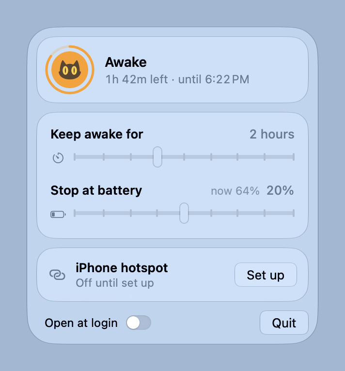

# NoSleep

A menu bar switch that keeps a Mac running with the lid closed. Turn it on for
good, for a set time, or until the battery reaches a level you pick.

<picture>
  <source media="(prefers-color-scheme: dark)" srcset="docs/panel-dark.png">
  
</picture>

## Install

**Homebrew**

```sh
brew install --cask intuito-studio/tap/nosleep
```

**One line, no Homebrew**

```sh
curl -fsSL https://raw.githubusercontent.com/intuito-studio/nosleep/main/install.sh | bash
```

**Download**: get `NoSleep.dmg` from
[Releases](https://github.com/intuito-studio/nosleep/releases/latest) and drag
NoSleep onto Applications. The first time you open it, macOS refuses because the
app isn't notarised. Go to **System Settings → Privacy & Security**, scroll down
to *"NoSleep" was blocked*, and click **Open Anyway**. Or clear the flag yourself:

```sh
xattr -dr com.apple.quarantine /Applications/NoSleep.app
```

Homebrew and the one-liner don't need this step. NoSleep is signed ad hoc, not
with a paid Apple Developer ID. Homebrew's cask clears the quarantine flag after
installing, and `curl` never sets it.

Needs macOS 14 or later, on Apple silicon or Intel.

## Use

Click the cat in the menu bar. It sleeps curled up when the Mac sleeps normally, and stares at a laptop, dark circles under its eyes, while the Mac is kept awake.

- **The big tile** is the switch. Click it to keep the Mac awake, and click
  again to go back to normal sleep.
- **Keep awake for** sets how long a session lasts, from 15 minutes to 8 hours.
  All the way right means no limit. Moving it during a session restarts the
  clock from now. A ring around the cat shows how much time is left, and the
  menu bar shows it as `1:42`.
- **Stop at battery** switches sleep back on once the battery drains to that
  level. It only applies on battery power. It's set to 20% by default, and
  dragging it all the way left turns it off.
- **Open at login** keeps it in the menu bar after a restart.

When a timer or the battery stop ends a session while the lid is shut, NoSleep
puts the Mac to sleep straight away, so it isn't left running in a bag.

### While the lid is closed

During a session, closing the lid turns the display off, mutes the audio and
switches on Low Power Mode. Opening it unmutes and switches Low Power Mode back
off. NoSleep only undoes what it did itself, so a mute or Low Power Mode you
set yourself stays. The timer keeps running throughout. The built-in microphone
is cut off in hardware while the lid is closed, so record with AirPods or an
external mic.

### Safety rules

- **Battery:** below 40% on battery, Low Power Mode goes on. At the stop you
  set (20% by default), the session ends.
- **Heat:** when macOS reports the Mac as seriously hot, Low Power Mode goes
  on. At critical heat, the session ends.
- **Notifications:** you get one when a timer, the battery or the heat ends a
  session.
- **Backstop:** a small launchd agent checks once a minute. If NoSleep has
  crashed or been force-quit while holding sleep off, it switches sleep, Low
  Power Mode and the mute back. It never touches a session the terminal started.

### iPhone hotspot

Off until you set it up in the panel. Give it your hotspot's name, as the
iPhone shows it. The password is optional if this Mac has joined that hotspot
before. During a session, if the network has been gone for 30 seconds, NoSleep
joins the hotspot, and tries again every minute until it is back. The password
stays in your login Keychain.

### Activity

The panel lists the last few things a session did: when the lid closed and
opened, what changed, and why a session ended.

Quitting NoSleep switches sleep back on if NoSleep was the one holding it off.

Features 1 to 6 and the hotspot follow [Insomnia](https://github.com/krishhgg/Insomnia)
(MIT), which got there first.

## How it works

Most stay-awake apps hold a power assertion, which stops idle sleep but not lid
sleep. Only `pmset disablesleep` stops lid sleep, and only root may change it.

The first time you flip the switch, macOS asks for your admin password once.
NoSleep then installs this rule as `/etc/sudoers.d/nosleep`, after checking it
with `visudo`:

```
you ALL=(root) NOPASSWD: /usr/bin/pmset -a disablesleep 0, /usr/bin/pmset -a disablesleep 1, /usr/bin/pmset sleepnow, /usr/bin/pmset -a lowpowermode 0, /usr/bin/pmset -a lowpowermode 1
```

The rule allows exactly those five commands with exactly those arguments, and
nothing else. Reading the current state needs no permission at all.

The terminal and the app use the same setting. If you run
`sudo pmset -a disablesleep 1` (or a shell function that wraps it), the menu
bar shows it within two seconds. Once the rule is installed, those exact
commands stop asking for a password in the terminal too.

## Uninstall

```sh
brew uninstall --zap --cask nosleep
```

Without Homebrew, quit NoSleep, then:

```sh
launchctl bootout gui/$(id -u)/dev.intuito.nosleep.backstop
rm ~/Library/LaunchAgents/dev.intuito.nosleep.backstop.plist
rm -rf /Applications/NoSleep.app
sudo rm /etc/sudoers.d/nosleep
defaults delete dev.intuito.nosleep
```

## Build

Needs Xcode (for `actool`, which compiles the icon), not just the Command Line Tools.

```sh
make run       # debug build → .build/NoSleep.app → relaunch it
make test
make release   # universal dist/NoSleep.dmg, and ../homebrew-tap/Casks/nosleep.rb updated
```

To ship a version: bump `VERSION`, run `make release`, and follow the steps it
prints. You tag and push, attach `dist/NoSleep.dmg` to a GitHub release, then
push the tap.
